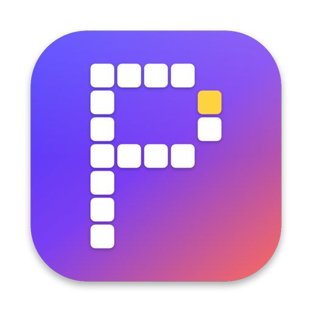
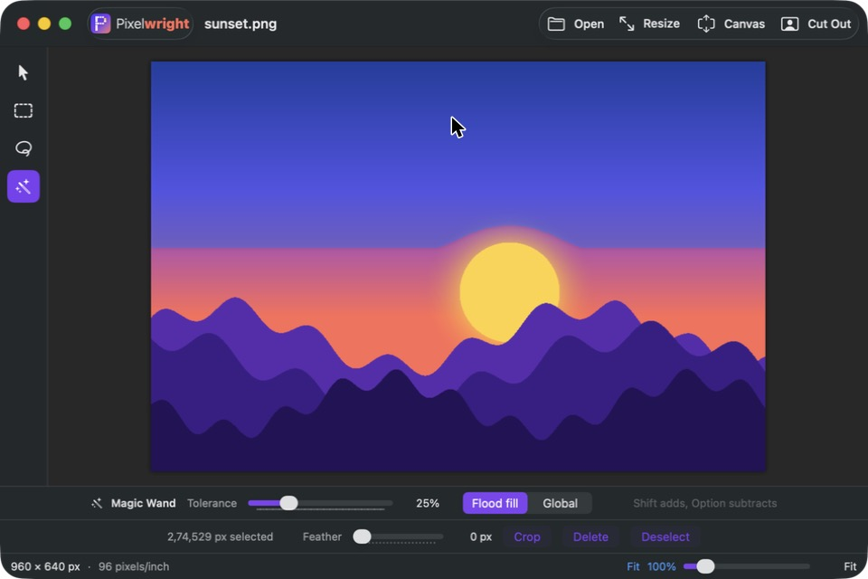

<p align="center">
  
</p>

<h1 align="center">Pixelwright</h1>

<p align="center"><b>Craft your pixels.</b><br>
A free, open-source image editor for Mac. Resize, crop, cut out backgrounds and tidy up photos<br>
without the bloat. <b>Everything stays on your Mac: no servers, no accounts, no uploads.</b></p>

<p align="center">
  
</p>

> **Status: early (0.1).** The everyday tools work and are tested, but this isn't a full editor
> yet. See the [roadmap](docs/roadmap.md).

## Private by design: your images never leave your Mac

Pixelwright works entirely on your computer. It has no server, no account and no cloud, and it
isn't connected to the internet at all. Every image you open, edit and save stays on the Mac where
the app is installed. Nothing is ever uploaded, because there is nowhere for it to go.

- **No server.** There is no Pixelwright service behind the app, so there is nothing to sign in to
  and nothing that can store, scan or lose your pictures.
- **No tracking.** No analytics, no crash reporting, no usage statistics, no update checks.
- **Works offline.** Everything, including background removal, runs on your Mac with Apple's
  built-in on-device frameworks.
- **Open source, so you can check.** The only web address in the whole code base is the link to this
  project page, which opens in your browser only if you click it.

Don't take our word for it. Three checks, each under a minute:

```bash
# 1. Look for any networking code. This prints nothing except the project link.
grep -rniE "URLSession|URLRequest|NWConnection|WebKit|https?://" Sources

# 2. Look for third-party code. There is none: no packages, only Apple's frameworks.
grep -c "\.package(" Package.swift     # prints 0

# 3. Run the app and ask macOS what it is connected to. This prints nothing.
lsof -i -n -P -a -p "$(pgrep -x Pixelwright)"
```

You can also block the app in a firewall such as Little Snitch or LuLu and nothing changes.

## What it does

**Resize and reshape**
- **Resize** by percentage or exact pixels, with an aspect-ratio lock and print size and
  resolution (inches or centimeters; the DPI is saved with the file). Eight resampling methods,
  and optional gamma-correct resizing that keeps brightness right when shrinking.
- **Canvas Size** with a 3x3 anchor grid and a fill of Transparent, White, Black or any color.
- **Crop** to a selection (cutting out its shape if it isn't a rectangle), **Auto-Crop** away
  transparent borders, **Rotate** and **Flip**.

**Cut things out**
- **Remove Background** in one click, using Apple's on-device Vision framework.
- **Selection tools**: Rectangle, Lasso and **Magic Wand** (tolerance, flood or global, add and
  subtract), plus Invert, Expand, Contract and **feathered** Delete for soft edges.
  See [docs/selection-and-wand.md](docs/selection-and-wand.md).

**Adjust**
- Brightness / Contrast, Hue / Saturation, Black and White, Sepia, Invert Colors, Blur, Sharpen
  and Pixelate, with a live preview. They apply to the selection if there is one.

**Careful with your files**
- **Your original files are never changed.** Edits happen on a copy in memory, and saving always
  writes a new file ("photo edited.jpg" next to the original). Replacing the original is possible
  only after an explicit warning. The title bar says so, shows an "edited" dot, and asks before you
  close or quit with unsaved changes.
- Every button has a tooltip, tools sit in a palette on the left, and **Help > Keyboard Shortcuts**
  lists everything.

**Save and share**
- **Save a Copy** (⌘S) or **Export** to PNG, JPEG, HEIC or TIFF with a quality slider, an optional size limit and a live
  file-size estimate.
- **Batch Resize** a whole folder of images in one go, to a size you choose, without touching
  the originals.
- Copy and paste (as a new image), undo and redo, zoom, drag-and-drop.

## Requirements

- macOS 14 (Sonoma) or later
- Xcode 16 or later (Swift 6) to build from source

## Build and run

```bash
git clone https://github.com/architpoddar/Pixelwright.git
cd Pixelwright

./scripts/make-app.sh      # builds build/Pixelwright.app
open build/Pixelwright.app
```

The build is ad-hoc signed, so it runs on the Mac that built it. For a quick developer
launch you can also use `swift run Pixelwright`.

Run the tests with:

```bash
swift test
```

## How it works

The image engine lives in its own library, `PixelwrightCore`, with no UI code. It resizes
using separable two-pass filtering on premultiplied float pixels, so transparent edges don't
bleed color, and it can work in linear light. The SwiftUI app is a thin layer on top.
See [docs/architecture.md](docs/architecture.md).

The exact behavior of Resize and Canvas Size (dialog rules, size limits, anchor math, kernels)
is written down in [docs/resize-canvas-spec.md](docs/resize-canvas-spec.md), and the tests check it.

## Contributing

Contributions are welcome. Please read [CONTRIBUTING.md](CONTRIBUTING.md) first, especially the
clean-room rule: **do not submit code or assets copied from Paint.NET or any other
proprietary program.** Developers and coding agents should also read [AGENTS.md](AGENTS.md).

## Name and look

"Pixelwright" means someone who builds with pixels, in the way a wheelwright builds wheels. The
logo is a pixel-art **P** with one yellow spark pixel. See [docs/branding.md](docs/branding.md)
for the colors, the logo and how to regenerate the artwork.

## Not affiliated

Pixelwright is an independent project. It is not affiliated with, endorsed by, or derived from
the source code of Paint.NET or dotPDN LLC. "Paint.NET" is a trademark of its owner and is
mentioned only to describe which everyday behaviors this app aims to feel familiar with.

## License

[MIT](LICENSE)
